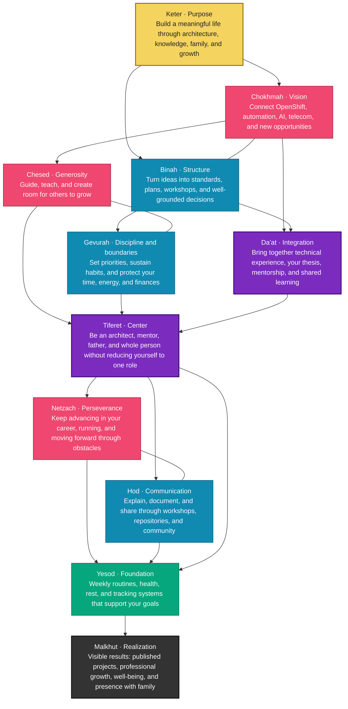

# Hi there 👋, I'm Heber Romero Téllez — `psehgaft`

**Architect @ Red Hat** · OpenShift · Kubernetes · DevSecOps · FaaS · Open Source

[![LinkedIn][linkedin-shield]][linkedin-url]

- 😄 Pronouns: he / him
- 📫 How to reach me: **@psehgaft** — [psehgaft.org](https://psehgaft.org)

## ⚡ Me, as a serverless function

```yaml
apiVersion: serving.knative.dev/v1
kind: Service
metadata:
  name: psehgaft
  labels:
    role: architect
    company: Red Hat
    since: "2016"
spec:
  template:
    metadata:
      annotations:
        autoscaling.knative.dev/min-scale: "1"   # always on, always learning
    spec:
      containers:
        - image: psehgaft/architect:latest
          env:
            - name: EXPERTISE
              value: "OpenShift | Kubernetes | DevSecOps | Hybrid Cloud"
            - name: PASSION
              value: "containers, cloud and open-source adoption"
            - name: PRIORITY
              value: "never stop learning"
          resources:
            requests:
              coffee: "1 cup"
              curiosity: "unbounded"
```

## 🔭 I'm currently working on ...

```yaml
currentlyWorkingOn:
  - Red Hat
  - Containerizing Applications
  - FaaS
  - DevSecOps
  - App Dev CNDF
```

## 🌱 I'm currently learning ...

```console
psehgaft@redhat:~$ cat currently_learning.txt
Computer systems
Dev Apps
Cloud and Hybrid cloud
psehgaft@redhat:~$ uptime
 10 years @ Red Hat, load average: curiosity 100%, boredom 0.00
psehgaft@redhat:~$ sudo make knowledge --target=all
[sudo] password for psehgaft: ••••••••
Compiling... done. Learning never stops.
```

## 🛠️ Skills on the prompt

```bash
skills=(
  "Podman + Docker + OpenShift + Kubernetes ☸️"
  "Ansible + Terraform"
  "Java + Spring Boot + Quarkus"
  "JavaScript + Node + React + Vue + Angular"
  "Python + Flask"
  "C# + .NET + ASP MVC"
  "Kotlin + Android"
)
for s in "${skills[@]}"; do echo "✅ $s"; done
```

## 👯 I'm looking to collaborate on ...

OpenShift / FaaS / Open Source

## 🤔 I'm looking for help with

OpenShift / FaaS / Open Source

## 💬 Ask me about

OpenShift / FaaS / Open Source

## ⭐️ Notable Projects and Contributions

- 🌐 **[Open Ecosystem Services](https://github.com/Open-Industries/open-ecosystem-services)** — serverless interoperability reference architectures, with the Open Industries community
- 🐴 **[KubeVirt Migration — Solution Pattern](https://github.com/psehgaft/solution-pattern-kubevirt-migration)** — Red Hat solution pattern for migrating VMs to OpenShift Virtualization · [live site](https://psehgaft.github.io/solution-pattern-kubevirt-migration/)
- 🎤 **[KubeVirt Without Fear — TXLF 2026](https://github.com/JoeRH-OCP/unify-KubernetesKubevit-workflows-TXLF2026)** — hands-on KubeVirt workshop built for Texas Linux Festival 2026
- 🏛️ **[Architect Diagrams](https://github.com/psehgaft/architect-diagrams)** — reference architecture diagrams: AWS, Azure Red Hat OpenShift, OpenStack and OpenShift Virtualization
- 🏠 **[psehgaft.org](https://psehgaft.org)** — my personal site: repository catalog, open-world map and more · [source](https://github.com/psehgaft/psehgaft.github.io)

## 📊 GitHub Stats


## 🌳 Tree of Life — The Sefirot

*Ten emanations, one single tree: the structure that sustains the universe — and good code.*



## ⚡ Fun fact

Always happy to help.

🎓 [Red Hat certification](https://rhtapps.redhat.com/verify?certId=170-241-434) · 🏅 [Credly badges](https://www.credly.com/users/psehgaft/badges) · ☕ [Buy me a coffee on Ko-fi](https://ko-fi.com/psehgaft)

[linkedin-shield]: https://img.shields.io/badge/LinkedIn-0077B5?style=for-the-badge&logo=linkedin&logoColor=white
[linkedin-url]: https://www.linkedin.com/in/psehgaft/
